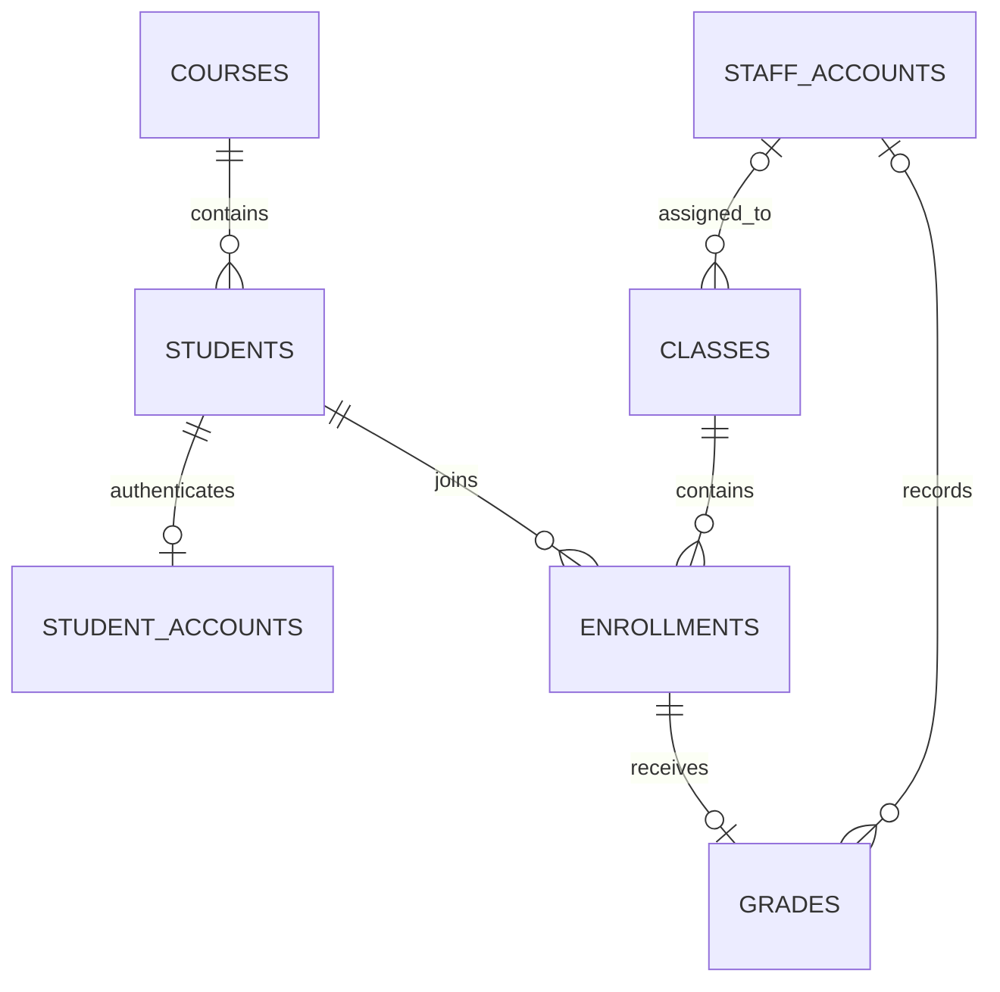

# Database design

Eight tables: `courses`, `students`, `student_accounts`, `staff_accounts`, `classes`, `enrollments`, `grades`, `audit_logs`.

- `courses`: unique program name; one course can have many students.
- `students`: personal records for every gender; FK course_id. Includes hashed, expiring activation code.
- `student_accounts`: unique student_id and username; password hash, active flag and session version. Account cannot exist without a student.
- `staff_accounts`: separate teacher/admin logins and role. No student account has a staff role.
- `classes`: unique code, description, schedule and nullable teacher_id; only teachers may be assigned by PHP. legacy_teacher stores unverified source display text only.
- `enrollments`: unique student/class pair, two FKs; joins the many-to-many relationship.
- `grades`: one score per enrollment, recorded_by FK to staff; legacy grades have no verified author. Decimal score 0–100. Teacher authorization in PHP additionally checks assigned class and enrollment.
- `audit_logs`: activity, actor role/id, target and time; actor fields intentionally historical rather than a polymorphic FK, so a deleted account does not erase its history.

Admin export and grade page use JOINs to retrieve real student and class names instead of duplicating them. The source did not include semester/term data, so grades remain a single score per class enrollment. No separate male/female tables or views are required.
