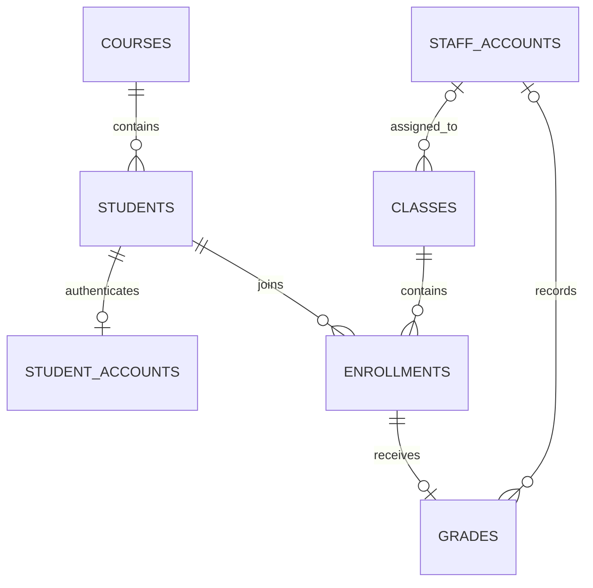

# Database design

Eight tables: `courses`, `students`, `student_accounts`, `staff_accounts`, `classes`, `enrollments`, `grades`, `audit_logs`.

- `courses`: unique program name; one course can have many students.
- `students`: personal records for every gender; FK course_id. Includes hashed, expiring activation code.
- `student_accounts`: unique student_id and username; password hash, active flag and session version. Account cannot exist without a student.
- `staff_accounts`: separate teacher/admin/enrollment-staff logins and role. No student account has a staff role.
- `classes`: unique code, description, schedule and nullable teacher_id; only teachers may be assigned by PHP. legacy_teacher stores unverified source display text only.
- `enrollments`: unique student/class pair, two FKs; joins the many-to-many relationship.
- `grades`: one final score per enrollment, plus five nullable component percentages (exam_score, quiz_score, project_score, attendance_score, participation_score); recorded_by FK to staff. Legacy grades keep their prior score and NULL components. Decimal scores 0–100. Teacher authorization in PHP additionally checks assigned class and enrollment.
- `audit_logs`: activity, actor role/id, target and time; actor fields intentionally historical rather than a polymorphic FK, so a deleted account does not erase its history.

Admin export and grade page use JOINs to retrieve real student and class names instead of duplicating them. The source did not include semester/term data, so grades remain a single score per class enrollment. No separate male/female tables or views are required.

V2 retains eight tables. Enrollment staff is represented by `staff_accounts.role = staff`; no additional account table is necessary. Existing `enrollments` links students to subjects (classes); staff may manage these links but cannot delete any with grades. No course curriculum-to-class mapping is supplied by the original schema, so staff select approved subjects manually.

## V4 additions

`academic_terms` (id, academic_year, semester) has one-to-many classes. `classes.term_id` is a foreign key; `classes.units` stores nullable verified subject credit units. `(class_name,term_id)` is unique so distinct terms preserve separate offerings. Curriculum maps stable codes by joining the original mapped class. `grade_assessments` has a many-to-one foreign key to `grade_periods` and stores each exam/quiz title, earned and maximum raw points. Periods have nullable `locked_at` and `locked_by` (staff FK); grade_summary exposes locked_count as well as the existing scores. Grade and assessment mutations are serialized with enrollment/class and grade-period row locks in a transaction. Legacy data remains unchanged unless an administrator assigns terms/units or teacher deliberately edits a draft. Authorization and locks are enforced by V4 PHP, not older apps or direct SQL access.
